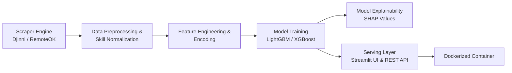

# Tech Labor Market & Compensation Intelligence

An end-to-end data analysis and machine learning system that scrapes tech job postings, extracts skill taxonomies and seniority signals, predicts salary benchmarks, and quantifies the compensation premium of technical skills using explainable AI.

---

## 1. Problem Statement & Business Objective
Compensation data in tech is often opaque, fragmented across regional job boards, and difficult for engineers and hiring managers to calibrate. 

This project builds an automated intelligence pipeline that answers two primary questions:
1. **Predictive Valuation:** What is the fair market salary range for a candidate given their tech stack, seniority, language proficiency, and work format (remote vs. hybrid)?
2. **Skill Value Attribution (Explainable AI):** Which technical skills (e.g., *Go + Docker* vs. *Python + Django*) provide the highest measurable salary uplift in current market conditions?

---

## 2. System Architecture



---

## 3. Data Pipeline & Feature Engineering

### Data Acquisition (Scraping)
* **Target Sources:** Public listings from tech hiring platforms (e.g., Djinni.co, RemoteOK) collected via `requests` + `BeautifulSoup` (or Playwright for dynamic elements).
* **Extracted Fields:** Job title, raw description, primary domain, required years of experience, English proficiency level, work format (remote/office/hybrid), posted date, and compensation (min/max bounds in USD).

### Feature Engineering
* **Skill Extraction & Normalization:** Text parsing and regex extraction to map heterogeneous tags into unified technology buckets (e.g., `Golang` -> `Go`, `Postgres` -> `PostgreSQL`).
* **Categorical Handling:** Target encoding and native categorical feature handling in LightGBM.
* **Seniority & Complexity Scores:** Heuristic scoring derived from required experience and seniority keywords.
* **Leakage Prevention:** Strict train/validation/test splitting prior to any target-based feature transformations.

---

## 4. Modeling & Machine Learning
* **Primary Model:** `LightGBM` Regressor (fast training, native handling of categorical features).
* **Comparison Baseline:** `RandomForestRegressor` and Ridge Regression.
* **Evaluation Metrics:**
  * Root Mean Squared Error (RMSE)
  * Mean Absolute Error (MAE)
  * Median Absolute Percentage Error (MedAPE)
  * $R^2$ Score
* **Interpretability (`SHAP`):**
  * TreeSHAP summary plots to identify global skill premiums.
  * Local waterfall plots showing positive/negative price drivers for individual salary estimates.

---

## 5. Deployment & Serving
* **UI Framework:** Streamlit dashboard allowing users to:
  * Input their tech stack, years of experience, and remote preference.
  * View predicted salary percentiles (25th, median, 75th).
  * See the top 3 highest-ROI skills to add to their profile for salary growth.
* **Containerization:** Single Docker container running the pre-trained model and Streamlit application.

---

## 6. Project Directory Layout
```text
01-tech-labor-market/
├── data/
│   ├── raw/             # Scraped raw JSON/HTML data
│   └── processed/       # Cleaned tabular datasets
├── src/
│   ├── scraper/         # Scraping scripts & parser logic
│   ├── features/        # Feature extraction & encoding pipeline
│   ├── models/          # Model training, hyperparameter tuning & SHAP evaluation
│   └── app/             # Streamlit dashboard
├── tests/               # Unit and data sanity checks
├── Dockerfile           # Production container configuration
├── requirements.txt     # Python dependencies
└── README.md
```
