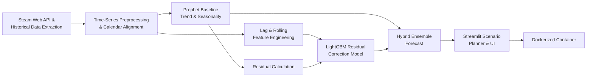

# Steam Player Demand & Trend Forecasting

An end-to-end time-series analysis and machine learning service that forecasts video game concurrent player demand on the Steam platform using a hybrid Prophet and gradient boosted decision tree (`LightGBM`) architecture.

---

## 1. Problem Statement & Business Objective
Indie game developers and publishers face high revenue uncertainty when scheduling game launches and discount promotions. Estimating future player counts and post-launch retention decay is critical for server capacity planning, marketing spend allocation, and timing seasonal sales.

This project delivers:
1. **Time-Series Forecasting:** Multi-horizon prediction of daily peak concurrent players across diverse game genres.
2. **Exogenous Factor Modeling:** Quantifying the uplift from Steam seasonal sales, weekend effects, major content patches, and discount depths.
3. **Hybrid Residual Architecture:** Combining structural trend/seasonality modeling (`Prophet`) with non-linear short-term lag correction (`LightGBM`).

---

## 2. System Architecture



---

## 3. Data Pipeline & Feature Engineering

### Data Acquisition
* **Target Sources:** Public endpoints from the Steam Web API and historical player tracking archives (SteamCharts / SteamSpy).
* **Metrics Ingested:** Daily active player counts, peak concurrent players, review velocity, historical price points, discount percentages, and release dates.

### Feature Engineering for Time Series
* **Temporal Lags:** Autoregressive features including $t-1$, $t-7$, $t-14$, and $t-30$ days.
* **Rolling Statistics:** 7-day, 14-day, and 30-day rolling means, standard deviations, and min/max ratios to capture momentum and volatility.
* **Calendar & Event Features:** Day of week, month, Steam seasonal sales (Summer/Winter/Spring/Autumn sales), and major update release flags.
* **Leakage-Free Cross-Validation:** Rolling-origin backtesting (`TimeSeriesSplit`) without future data bleeding into past predictions.

---

## 4. Modeling & Machine Learning
* **Stage 1 (Prophet Baseline):** Decomposes the time series into long-term growth trends, weekly cycles (weekend surges), and recurring annual holiday spikes.
* **Stage 2 (LightGBM Gradient Boosting):** Learns residual prediction errors from Prophet using engineered lag, discount, and event features.
* **Evaluation Metrics:**
  * Weighted Absolute Percentage Error (WAPE)
  * Mean Absolute Error (MAE)
  * Root Mean Squared Error (RMSE)
  * Mean Absolute Scaled Error (MASE) against a naive seasonal baseline

---

## 5. Deployment & Serving
* **UI Framework:** Streamlit interactive scenario simulator:
  * Select or upload a game profile (genre, price, historical player curve).
  * Simulate future demand under different discount strategies (e.g., 20% off vs. 50% off during Steam Winter Sale).
  * Visualize confidence intervals and predicted player retention curves.
* **Containerization:** Self-contained Docker image exposing the Streamlit dashboard.

---

## 6. Project Directory Layout
```text
02-steam-demand-forecast/
├── data/
│   ├── raw/             # Raw API responses and time-series snapshots
│   └── processed/       # Interpolated, date-aligned time series
├── src/
│   ├── ingestion/       # Steam API / historical data collectors
│   ├── features/        # Lag, rolling window & calendar feature generators
│   ├── models/          # Prophet baseline, LightGBM residual trainer & backtesting
│   └── app/             # Streamlit interactive forecasting app
├── tests/               # Validation tests for leakage & data alignment
├── Dockerfile           # Production container configuration
├── requirements.txt     # Python dependencies
└── README.md
```
