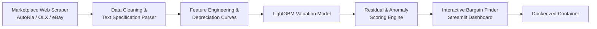

# Second-Hand Market Valuation & Deal Spotter

An end-to-end data analysis and machine learning platform that scrapes real-world marketplace listings, estimates fair market values using gradient boosted decision trees (`LightGBM`), and detects statistical pricing anomalies to highlight high-value bargains while filtering out suspicious/fraudulent listings.

---

## 1. Problem Statement & Business Objective
Second-hand marketplaces (vehicles, consumer electronics, and computing hardware) suffer from information asymmetry and noisy price dispersion. Buyers struggle to differentiate genuine bargains from overpriced items or suspiciously low-priced scams ("lemons").

This project addresses this challenge through:
1. **Fair Market Value Estimation:** High-precision regression predicting what an item *should* cost given its exact specifications, condition, age, and regional location.
2. **Deal & Anomaly Detection:** Residual-based classification ($y_{\text{actual}} - y_{\text{predicted}}$) to label listings into actionable tiers:
   * **Super Deal:** Statistically underpriced (e.g., > 1.5 standard deviations below market value).
   * **Fair Market:** Within expected margin of error ($\pm 10\%$).
   * **Overpriced:** Significantly above market price.
   * **Anomaly / Risk Flag:** Extremely low price with missing seller history or conflicting specs (likely scam or damaged goods).

---

## 2. System Architecture



---

## 3. Data Pipeline & Feature Engineering

### Data Acquisition (Scraping)
* **Target Sources:** Public listings from second-hand marketplaces (e.g., vehicle marketplace AutoRia or hardware marketplace OLX/eBay completed sales) using structured HTML parsing.
* **Extracted Fields:** Title, listing price, manufacturer/brand, model, production year, odometer/usage, technical attributes (engine/transmission or GPU chip/VRAM), city/region, and posting timestamp.

### Feature Engineering
* **Depreciation & Age Curves:** Non-linear transformations modeling exponential price decay over time and usage.
* **Equipment & Option Parsing:** High-cardinality categorical feature encoding for vehicle trim levels or hardware revisions.
* **Geographic Feature Clustering:** Location encoding to account for regional price variance.
* **Outlier Filtration:** Isolation Forests and IQR-based filtering on training data to remove erroneous or manipulated listings before training.

---

## 4. Modeling & Machine Learning
* **Primary Regressor:** `LightGBM` Regressor (leveraging native handling of categorical features and fast inference).
* **Baseline Regressor:** Random Forest and Ridge Regression for performance benchmarking.
* **Residual Analysis Engine:**
  $$\text{Price Delta} = \frac{P_{\text{actual}} - P_{\text{predicted}}}{P_{\text{predicted}}} \times 100\%$$
* **Evaluation Metrics:**
  * Mean Absolute Percentage Error (MAPE)
  * Median Absolute Error (MedAE)
  * Root Mean Squared Error (RMSE)
  * Precision of Deal Classification (verified against market absorption speed)

---

## 5. Deployment & Serving
* **UI Framework:** Streamlit dashboard offering:
  * **Deal Radar:** Live feed of scraped listings ranked by the largest discount vs. model prediction.
  * **Valuation Tool:** Interactive calculator where users input specifications to receive fair value estimates with confidence intervals.
  * **Market Heatmaps:** Visualizations showing depreciation trajectories by brand and model.
* **Containerization:** Production Dockerfile packaging the data pipeline, trained weights, and Streamlit app.

---

## 6. Project Directory Layout
```text
03-secondhand-deal-spotter/
├── data/
│   ├── raw/             # Scraped HTML/JSON snapshots
│   └── processed/       # Cleaned tabular datasets
├── src/
│   ├── scraper/         # Scraping engine with rate limiting & parser logic
│   ├── features/        # Depreciation transforms & categorical encoders
│   ├── models/          # Valuation model training & residual deal spotter
│   └── app/             # Streamlit Deal Radar application
├── tests/               # Feature validation & model inference tests
├── Dockerfile           # Production container configuration
├── requirements.txt     # Python dependencies
└── README.md
```
