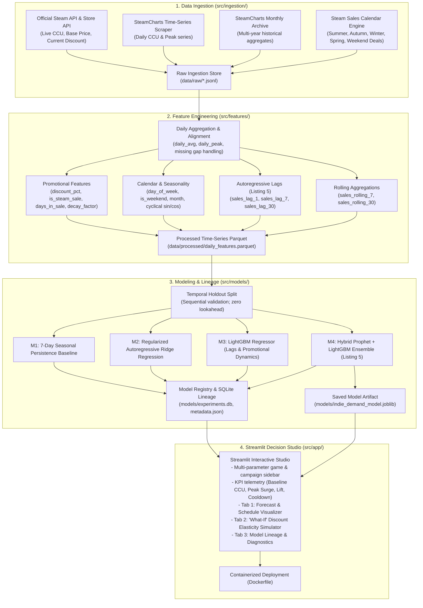

# Steam Indie Game Demand Forecasting & Promotional Scheduler

## Objective
Ingest historical player activity from the Steam platform and build time-series models to forecast daily concurrent player demand, analyze promotional discount elasticity, and provide an interactive sales scheduling tool for indie game developers conforming to the hybrid **Prophet + LightGBM** architecture outlined in [program.pdf](file:///home/yur4uwe/Downloads/program%20%281%29-1.pdf#L16631).

---

## Technical Architecture



---

## Running Instructions

### Local Execution with uv
```bash
# Sync dependencies (creates/updates environment automatically)
uv sync

# Ingest historical & real-time Steam data
uv run python -m src.ingestion.runner

# Build feature matrices
uv run python -m src.features.builder

# Train models and record lineage (M1 - M4)
uv run python -m src.models.train

# Option A: Decoupled Production Mode (Recommended - Zero UI Stutter)
# Terminal 1: Launch FastAPI forecasting service (Port 8000)
uv run python -m src.api.server

# Terminal 2: Launch Streamlit decision studio (Port 8501)
uv run streamlit run src/app/main.py

# Option B: Standalone Mode (In-Process Fallback)
uv run streamlit run src/app/main.py
```

To add new dependencies to this project:
```bash
uv add <package-name>
```

### Containerized Execution with Docker
```bash
# Build Docker image
docker build -t steam-demand-forecast .

# Run container
docker run -p 8501:8501 steam-demand-forecast
```

---

## Directory Structure

```text
2-steam-demand-forecast/
├── data/
│   ├── raw/                 # Raw API & scraper payloads
│   └── processed/           # Aligned daily time-series Parquet files
├── models/
│   ├── experiments.db       # SQLite model lineage tracker
│   ├── metadata.json        # Production model metadata & metrics
│   └── indie_demand_model.joblib
├── src/
│   ├── ingestion/           # Steam API, SteamCharts scraper, sales calendar
│   ├── features/            # Autoregressive lags, rolling windows, promo indicators
│   ├── models/              # Prophet baseline, LightGBM, Hybrid, Registry & Lineage
│   └── app/                 # Streamlit decision studio
├── tests/                   # Ingestion, feature integrity, and model unit tests
├── Dockerfile
├── pyproject.toml
└── README.md
```

---

## Status & Roadmap

- [x] **Step 1: Environment & Project Setup** (`pyproject.toml`, `uv sync`)
- [x] **Step 2: Ingestion Pipeline Setup** (`steam_client.py`, `steamcharts.py`, `sales_calendar.py`)
- [x] **Step 3: Time-Series Feature Engineering** (`lags.py`, `rolling.py`, `promotions.py`, `builder.py`)
- [x] **Step 4: Modeling & Experiment Lineage** (`prophet_model.py`, `lgbm_model.py`, `hybrid.py`, `lineage.py`, `train.py`)
- [x] **Step 5: Streamlit Decision-Support Studio** (`main.py` with multi-parameter sidebar, 3 analytical tabs)
- [x] **Step 6: Unit Testing & Docker Packaging** (`tests/`, `Dockerfile`)
